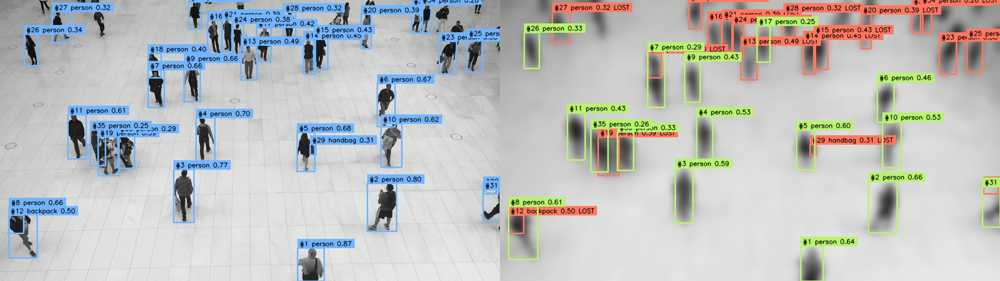

# Breakpoint

**How much controlled image corruption makes an object detector lose what it could see?**

A small research instrument for the Roboflow Labs exercise. Run a real detector, sweep three independent perturbations, inspect the first observed failure crossing, and follow individual reference objects. Built with **Roboflow Inference**, **Inference SDK**, **Supervision**, and Streamlit.



## Run it

This workspace is already set up:

```bash
.venv312/bin/streamlit run app.py
```

Open **http://localhost:8501**. It starts in **Recorded real experiment**, an instant replay of the included real 51-call RF-DETR experiment. No credentials or model downloads are needed for replay. Choose **Run live inference**, keep the default local RF-DETR Small model, and click **Run robustness experiment** for fresh predictions.

For a fresh checkout, use **Python 3.12**:

```bash
python3.12 -m venv .venv312
source .venv312/bin/activate
pip install -r requirements-local.txt
streamlit run app.py
```

The native Inference distribution has substantial optional-model dependencies (roughly 2 GB in the tested environment). The first local run downloads about 125 MB of RF-DETR weights and may spend a minute or two initializing/compiling the runtime on a Mac. Subsequent sweeps are much faster. Prewarm before presenting. Model caches stay in `.cache/` and are excluded from Git.

For **replay and HTTP inference only**, install `requirements.txt` instead. Select **HTTP · Roboflow SDK** in the app; the default server is Roboflow Serverless. Create `.env` from `.env.example` and add `ROBOFLOW_API_KEY` for hosted inference/private models. Keys stay out of exports and use header authentication. For an existing self-hosted Inference Server, set its URL (e.g. `http://localhost:9001`). HTTP inputs are sent to that server; hosted requests can consume account credits. The local RF-DETR demo requires no API key.

Inference model IDs use **project/version**, for example `vehicle-detection-wvcx6/1`, rather than `workspace/project/version`. The app automatically removes a workspace prefix and shows the ID it will use. Private-model keys are passed explicitly to both local and HTTP inference. The app rereads `.env` on rerun, including edited keys; file values override existing environment values.

## Measured result

Included run `8bb6c4e29308cee3`, captured October 22, 2026, uses RF-DETR Small (`rfdetr-small`, resolved locally to `coco/39`) on the official people-walking example resized to **960 × 540**. Evaluation confidence is **0.25**, matching IoU **0.50**, and failure means **strictly less than 50% retention**.

| Perturbation | First observed crossing | At crossing | Physical condition |
|---|---|---|---|
| Gaussian blur | Severity (0.30, 0.40] | 16/35 retained (45.7%) | Gaussian σ = 7.56 pixels |
| Low lighting | Severity (0.50, 0.60] | 7/35 retained (20.0%) | Encoded pixel values × 0.01585 |
| Gaussian noise | Not observed through severity 1.0 | At maximum, mean retention 77.1% | Noise σ = 100 intensity levels; 3 trials |

These are observations about **one image, model, runtime, and corruption schedule**. They are not universal thresholds. Full evidence: [raw experiment](artifacts/demo.json), [results summary](artifacts/demo.csv), [column guide](artifacts/demo.guide.md), [generated report](artifacts/demo.md).

## Methodology

The experimental unit is one image. The question concerns **clean-reference detection consistency**, using the model's own clean detections as reference objects. We do not have human ground truth.

- Decode and orient the image; resize its longest edge to at most 960 pixels. Save those actual experimental pixels losslessly in the bundle and compute their SHA-256.
- Infer the clean reference once. Capture raw detections above a fixed **0.05** confidence floor. Request an inference IoU parameter of **0.50**; backend/model postprocessing determines whether NMS applies (RF-DETR is an end-to-end detector). This is separate from the evaluation matching IoU.
- Independently transform the original at eleven severities `s ∈ {0, .1, …, 1}`. Never chain corruptions. Geometry is unchanged, so boxes remain in the same coordinates.
- **Blur:** Gaussian σ = `0.035 × min(height, width) × s` pixels. **Darkness:** multiply encoded BGR values by `10^(-3s)`, round and clip. **Noise:** add independent per-pixel/per-channel Gaussian noise with σ = `100s`, round and clip to [0, 255]. Zero severity is an exact copy.
- Blur/darkness have one realization each; noise has three seeded trials. Trial seed = `42 + trial_index`. A trial uses the same standard-normal field across severities (common random numbers). Severity-zero results reuse the clean response. Default total: `1 + 10 × (1 + 1 + 3) = 51` real inference calls, represented by 53 analysis rows including three shared controls.
- Filter reference and current detections at the selected evaluation confidence. Supervision converts the responses and computes pairwise box IoU. Eligible pairs have the same class name and IoU at or above the matching threshold. A maximum-weight bipartite assignment maximizes the number of valid one-to-one matches, then their summed IoU. A current box cannot explain two reference objects.
- **Retention** = matched references / clean references. No clean references means **undefined**, never zero or perfect robustness. **Confidence mass** = sum of matched prediction scores / number of clean references, with unmatched references contributing zero. It is not a calibrated probability.
- The **boundary bracket** is the preceding sampled severity and the first sampled severity whose mean retention falls strictly below the criterion. Later recovery is allowed. **Noise bands** show min/max across trials, not confidence intervals. The exported **retention AUC** uses trapezoidal integration over the chosen severity schedule; it is schedule-dependent.

An inference error aborts the sweep; it is never converted into an empty prediction or a model failure. Changing evaluation thresholds needs no new calls, but thresholds below the capture floor require rerunning inference. The reported call duration covers the sweep, excluding model initialization; it is not a detector benchmark.

## Reproduce from the command line

```bash
# Fresh real local inference; writes JSON, CSV, and Markdown
.venv312/bin/python scripts/run_experiment.py --output artifacts/runs/my-run.json

# Quick 13-call sweep: five levels, one noise trial
.venv312/bin/python scripts/run_experiment.py --steps 5 --trials 1 --output artifacts/runs/quick.json

# Hosted or existing self-hosted Inference Server
.venv312/bin/python scripts/run_experiment.py --backend http \
  --api-url https://serverless.roboflow.com --model rfdetr-small \
  --output artifacts/runs/hosted.json

# Reanalyze the included real responses without any model or network
.venv312/bin/python scripts/run_experiment.py --replay artifacts/demo.json \
  --confidence 0.40 --iou 0.50 --output artifacts/runs/reanalyzed.json
```

The exported JSON contains the lossless input PNG, pixel hash, configuration, timestamp, package versions, seeds, physical values, and raw predictions. Its `evaluation` section records the chosen confidence, matching IoU, and cutoff; pass these explicitly when using the CLI to reproduce that view. Model aliases can resolve differently later, and hardware/provider changes can affect fresh predictions. Reanalysis of the stored raw responses is the stable evidence trail. Model weights are cached locally, not committed.

## Validation

```bash
.venv312/bin/pip install -r requirements-dev.txt
MPLCONFIGDIR=/tmp/breakpoint-mpl .venv312/bin/python -m pytest -q tests \
  --cov=breakpoint --cov-report=term-missing
```

Tests cover identity, seeded noise, parameter bounds, class-aware maximum-cardinality matching, duplicate-match prevention, empty references, nonmonotonic crossings, exact input round trips, inference call counts, error propagation, and actual Streamlit control interactions. Real native inference and a live browser run were also exercised; these are intentionally separate from the fast suite so tests do not require network access or model downloads. See [VALIDATION.md](VALIDATION.md).

## Limitations and next experiment

**Consistency is not correctness.** Clean errors can survive; objects missed in the clean image are absent from the denominator. Unmatched current predictions may be newly detected real objects, shifted boxes, or errors—we cannot call them false positives without annotations. Thresholds and matching ambiguity affect the result. Small objects lose retention for several possible reasons, not necessarily one underlying model weakness.

**Synthetic corruption is limited.** Multiplying encoded pixels is not a physically accurate low-light camera model; real low lighting also changes shot noise, exposure, motion blur, and white balance. Gaussian noise clips at the intensity limits. The model resizes and preprocesses inputs internally, which affects the observed response. Severity is not comparable across corruption families; do not interpret AUC as an intrinsic ranking of difficulty.

**The sample is small.** Three noise draws do not establish population uncertainty. They share one image and reference; variation bands only describe those draws. The next useful extension is a small held-out, human-annotated image set spanning object sizes, repeated across two fixed model versions. Then measure true recall/mAP, aggregate by image, and bootstrap images rather than pretending object boxes or noise draws are independent dataset samples.

## Implementation and sources

Small Python modules separate perturbations/matching (`breakpoint/core.py`), sweep capture (`experiment.py`), Roboflow adapters (`detector.py`), summaries (`report.py`), and Supervision visualization (`visuals.py`). Streamlit is the only app layer; there is no database or separate frontend build.

Official documentation consulted for the installed APIs:

- [Roboflow native Python API](https://docs.roboflow.com/reference/inference/inference-python/native-python-api): `get_model`, `.infer`, response objects, BGR image input.
- [Inference SDK](https://docs.roboflow.com/reference/inference/inference-sdk) and [configuration](https://docs.roboflow.com/reference/inference/inference-sdk/configuration): `InferenceHTTPClient`, fixed capture thresholds, header key transport, and disabled active learning for HTTP experiments.
- [Supervision Detections](https://supervision.roboflow.com/latest/detection/core/) and [IoU utilities](https://supervision.roboflow.com/detection/utils/): response conversion and pairwise box overlap, plus `BoxAnnotator` and `LabelAnnotator` for visual evidence.
- [Official example image](https://media.roboflow.com/inference/people-walking.jpg), downloaded unchanged into `assets/people-walking.jpg` for reproducible use. Image is supplied by Roboflow's documentation; no independent ownership or license claim is made.

The repository's `Roboflow Exercise [EXT].pdf` asks for an open-ended project and ten-minute presentation. This scope deliberately favors one measurable experiment and an inspectable demo over training a model or building infrastructure.
